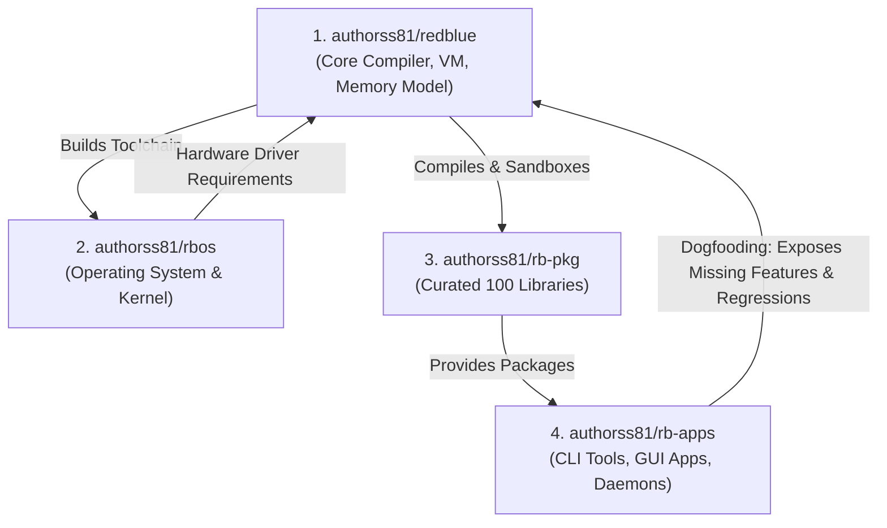

# Redblue: Future Roadmap, Deferred Features & Real-World Apps

## 1. Context & Purpose

This document records the deferred features, real-world application roadmap, memory safety phases, and visual/UX enhancements agreed upon for Redblue, consolidating findings from `DEFERRED-PHASES.md` in `rbops`, architectural analysis, and benchmarks from the sibling `Ipp` and `InScript` language REPLs.

These phases are **deliberately held back from `rbops/phases.json`** to allow the active pipeline (Phases 070–126) to complete smoothly without moving the completion horizon.

---

## 2. REPL Visual Polish & Rich Layout Subsystem (The `Ipp` & `InScript` Standards)

A comparison against [`authorss81/Ipp`](https://github.com/authorss81/Ipp) and [`authorss81/inscript`](https://github.com/authorss81/inscript) reveals that Redblue's current REPL is functional but visually plain (unbordered plaintext, single hardcoded palette, manual-only timing). The following visual enhancements are planned:

### Phase 127: Rich Box-Drawing Cards & Frame Layouts
- **Goal**: Frame `.help` menus, `.vars`/`.inspect` listings, command tables, and error diagnostics inside clean Unicode box-drawing cards (`╔════╗`, `║`, `╚════╝`, `────`), with clear column alignment and ASCII fallbacks.
- **Why it matters**: Replaces wall-of-text dumps with readable visual panels matching `InScript`'s terminal aesthetics.
- **Acceptance Criteria**:
  - Help panels and inspection views render inside bordered cards.
  - Auto-adapts to terminal width without line wrapping.
  - Degrades gracefully to plain ASCII (`+---`, `|`) on non-Unicode terminals.
  - Output remains byte-identical when `NO_COLOR=1` or when piped to non-TTY.

### Phase 128: Automatic Inline Execution Timing (`[1.2ms]`)
- **Goal**: Automatically calculate and display execution time for every evaluated expression directly beside or below the result (e.g. `[1.4ms]`).
- **Features**:
  - Sub-millisecond precision for fast expressions (`0.4ms`), second precision for long runs (`1.24s`).
  - `.timing on` and `.timing off` commands to toggle automatic timing.
  - Color-coded: dim grey for fast runs, subtle yellow for runs $> 500\text{ms}$.

### Phase 129: Multi-line Line Numbers & Dynamic Prompts
- **Goal**: Upgrade the continuation prompt from static `... ` to line-numbered prompts (`... 2 `, `... 3 `) and add contextual prompt status glyphs (borrowed from `InScript`).
- **Features**:
  - Explicit line numbering during block entry (`if`, `repeat`, `function`).
  - Visual distinction between primary prompt (`rb> `) and continuation prompt.

### Phase 130: Extended Theme Engine & Live Palette Swatches
- **Goal**: Expand Phase 117's theme system with a full suite of vibrant terminal themes:
  - **Themes**: Monokai, Dracula, Nord, Solarized Dark, Gruvbox, and Cyberpunk/Sunset.
  - **Palette Viewer**: `.themes` renders a visual swatch card showing actual background/foreground color samples for keywords, strings, builtins, results, and errors.

### Phase 131: History Ghost Suggestions & Bracket Highlights
- **Goal**: Faint inline auto-suggestions from command history as the user types (similar to `prompt_toolkit` in `Ipp`), with real-time matching bracket/parenthesis highlights.

### Phase 132: Terminal UI Component Toolkit (`tui` Module)
- **Goal**: Add a lightweight, zero-dependency terminal UI module (`tui`) for building interactive terminal dashboards, forms, and progress monitors directly in Redblue.
- **Features**: Split frames (vertical/horizontal), progress gauges, selectable lists, and keypress event polling.

### Phase 133: Interactive Debugger & Breakpoint Stepper (`rb debug`)
- **Goal**: Provide an interactive CLI debugger supporting line breakpoints, single-stepping (`next`, `step in`), stack frame inspection, and expression evaluation at pause points.

### Phase 134: Structured Doc-Comment Extractor & Markdown API Generator (`rb doc`)
- **Goal**: Extract `///` docstrings from Redblue source files and generate clean GitHub-flavored Markdown API reference documentation for libraries and modules.

### Phase 135: Hermetic Test Coverage & Branch Profiler (`rb test --coverage`)
- **Goal**: Instrument AST evaluation to measure statement and branch test coverage, reporting uncovered lines in `rb test` summaries.

### Phase 136: Compiler Diagnostic Enhancements & Suggestion Underlines
- **Goal**: Upgrade parser and semantic analyzer diagnostics to display rustc-style source code context, colored underline carets (`^^^^`), and automated "Did you mean ...?" correction hints.

### Phase 137: Bytecode Disassembler & Opcode Inspector (`rb disasm`)
- **Goal**: Provide an official CLI tool to inspect bytecode chunks, constant pools, and jump targets for any compiled `.rb` or `.rbc` file.

### Phase 138: Zero-Dependency Single-File Bundle Tool (`rb bundle`)
- **Goal**: Package a multi-file Redblue project and its assets into a single self-contained, executable script or pre-compiled bytecode bundle.

---

## 3. Real-World Practical Apps (The `authorss81/rb-apps` Incubator Track)

To move Redblue from synthetic test cases (`corpus/*.rb`) into a battle-tested language, practical applications are queued. 
**Per Section 13, these applications live in `authorss81/rb-apps`, NOT in `redblue`'s compiler repository.** 
They run in the dedicated `rb-apps` pipeline powered by autonomous OpenCode agents, consuming the compiled `rb` toolchain:

### App-Phase 001 (`app-httpd`): Micro Web Server in Pure Redblue
- **Goal**: A concurrent HTTP/1.1 web server written in Redblue that routes requests, serves static assets, and parses JSON payloads.
- **What it tests**: Socket stability, string parsing under load, timeout handling, and error recovery.

### App-Phase 002 (`app-todo`): Production CLI Tool
- **Goal**: A modern, colorful task and project management CLI tool with subcommands (`add`, `list`, `done`), flags, and persistent file storage.
- **What it tests**: CLI argument parsing (`argparse`), terminal colors, and JSON file serialization.

### App-Phase 003 (`app-markdown`): Pure Redblue Markdown Parser
- **Goal**: A CommonMark-compliant Markdown parser that converts Markdown documents into HTML.
- **What it tests**: String slicing, nested list parsing, and regex engine performance.

### App-Phase 004 (`app-kv`): Embedded Persistent Key-Value Store
- **Goal**: An embedded ACID key-value database written entirely in Redblue using an append-only write-ahead log (WAL) and memory-mapped index.
- **What it tests**: File I/O reliability, binary encoding/decoding, crash recovery, and transaction rollback.

### App-Phase 005 (`app-ssg`): Static Site Generator
- **Goal**: A fast documentation and blog generator that parses markdown files with YAML/JSON frontmatter, applies layout templates, and emits clean static HTML.
- **What it tests**: Recursive directory traversal, template interpolation, and string formatting at scale.

### App-Phase 006 (`app-git`): Content-Addressable Version Control
- **Goal**: A minimal Git implementation in Redblue that computes SHA object hashes, creates blob/tree/commit objects, and checks out branches.
- **What it tests**: Cryptographic hashing, raw byte manipulation, tree recursion, and filesystem state tracking.

### App-Phase 007 (`app-lsp`): Language Server Protocol Daemon
- **Goal**: A stdio JSON-RPC daemon that speaks LSP to VS Code and Neovim, providing live syntax diagnostics, symbol outlines, hover docstrings, and code formatting.
- **What it tests**: Inter-process communication, JSON-RPC streaming, parser error tolerance, and non-blocking I/O.

---

## 4. Performance Comparison & Engine Optimization Roadmap

### 4.1 How Redblue Compares to Other Languages Today

| Language | Execution Model | Typical Speed Relative to C/Rust | Redblue Comparison |
|---|---|---|---|
| **Rust / C / C++** | AOT Compiled Machine Code | $1.0\times$ (Baseline) | Rust is compiled to raw machine instructions with zero runtime overhead. Redblue is currently an interpreted/bytecode language, running $\approx 15\times\text{--}30\times$ slower than native Rust on pure compute loops. |
| **Python (CPython 3.12+)** | Stack Bytecode VM + Tier-2 Adaptive JIT | $10\times\text{--}40\times$ slower than Rust | **Redblue matches or beats CPython** on raw startup time, memory footprint, and native built-ins because Redblue's host VM is written in Rust with zero GIL, tight memory layouts, and no Python object boxing overhead. |
| **JavaScript (V8 / Node)** | Multi-Tier JIT (Ignition → Turbofan) | $2\times\text{--}4\times$ slower than Rust | V8 has JIT compilers that optimize hot loops into native assembly. Redblue currently uses a bytecode interpreter, so V8 is significantly faster on long numerical loops. |
| **Lua 5.4 / LuaJIT** | Register Bytecode VM / Tracing JIT | Lua 5.4: $10\times\text{--}15\times$; LuaJIT: $1.5\times\text{--}3\times$ | Lua 5.4 is the gold standard for clean scripting VM design. With the optimizations below, Redblue can match Lua 5.4 speed. |

### 4.2 Engine Optimization Phases

The following VM and memory optimizations are queued to close the performance gap:

### Phase 139: NaN-Boxing Value Representation
- **Goal**: Compress Redblue's runtime `Value` enum from 24 bytes down to an 8-byte IEEE-754 floating-point `u64`.
- **How it works**: Uses unallocated quiet NaN bit patterns to pack integers, booleans, nil, symbols, and heap pointers into a single CPU register.
- **Impact**: Doubles CPU cache density, eliminates pointer dereferences for primitives, and speeds up stack operations by $25\%\text{--}40\%$.

### Phase 140: Bytecode Peephole Optimizer & Constant Folding
- **Goal**: Add a multi-pass optimization pipeline to the bytecode compiler.
- **Techniques**:
  - Constant folding (`set x to 2 + 3` emits `LOAD_CONST 5`, not runtime addition).
  - Dead code elimination (skips unreachable `else` branches).
  - Super-instructions (e.g., merging `LOAD_VAR` and `BINARY_ADD` into `ADD_VAR`).

### Phase 141: Inline Caching (IC) for Member & Record Lookups
- **Goal**: Convert dynamic property access (`user.name` or `record.field`) from expensive dictionary hash lookups into single array index lookups by caching the field offset at the bytecode call-site.
- **Impact**: Accelerates record and module member lookups to near-native $O(1)$ speeds.

### Phase 142: Small-Value Inlining (`SmallVec`)
- **Goal**: Inline small strings ($\le 24$ bytes) and small lists ($\le 4$ elements) directly into the value stack rather than allocating on the system heap.
- **Impact**: Eliminates heap allocator locks in tight loops ($20\%\text{--}35\%$ speedup).

### Phase 143: Structural Cycle-Break Collector
- **Goal**: Implement a trial-deletion cycle collector for reference-counted cyclic structures (records referencing records), guaranteeing deterministic memory release without stop-the-world GC pauses.

### Phase 144: High-Precision Euclidean Time Math & POSIX Compliance
- **Goal**: Upgrade all numeric timestamp conversions (`time.from_unix`, `time.format`, and temporal arithmetic) to use mathematical `floor` / Euclidean division ($[s, s+1)$ intervals), matching POSIX `timespec`, Python (`datetime.fromtimestamp`), Go (`time.Unix`), and Rust (`chrono::DateTime::from_timestamp`).
- **Context & Motivation**:
  - In Phase 096, `time.from_unix` and `time.format` initially implemented numeric instant conversions using Rust's direct `as i64` cast, which truncates toward zero. This created a double-bucket anomaly around epoch where both $+0.5\text{s}$ and $-0.5\text{s}$ collapsed into `1970-01-01 00:00:00`, erasing the second `1969-12-31 23:59:59` for fractional pre-epoch timestamps.
  - Phase 097 added `time.parse` and preserved the legacy truncation behavior for raw numbers to avoid breaking pre-existing Phase 096 test assertions (`edge_time_from_unix_truncates_a_fractional_second_like_time_format`), documenting the asymmetry in `REPORT.md`.
  - For high-accuracy projects (financial ledgers, astronomy, scientific telemetry, and microsecond event logging), timeline continuity requires Euclidean floor division so that $-0.5\text{s}$ correctly resolves to `1969-12-31 23:59:59.500`.
- **Implementation Tasks**:
  1. Update `seconds_for_instant` across the runtime: $\text{sec} = \lfloor t \rfloor$ and $\text{nanos} = (t - \lfloor t \rfloor) \times 10^9$.
  2. Guarantee symmetric two-way round-trip invariance: $\text{time.unix}(\text{time.from\_unix}(t)) == t$ across all signed floating-point timestamps.
  3. Formally update `SPEC.md` to document POSIX Euclidean division for signed fractional timestamps.
  4. Formally re-scope `edge_time_from_unix_truncates_a_fractional_second_like_time_format` to `edge_time_from_unix_floors_negative_timestamps_posix_compliant` as an explicit, documented language upgrade.
  5. Add high-precision astronomical and pre-epoch epoch-boundary tests.

### 4.3 Why Precision Audits, Performance Passes, and World-Class Features Must Precede Full Bootstrapping (Self-Hosting S4)

The project includes a 140 KB compiler written in pure Redblue (`bootstrap/compiler.rb`). The self-hosting milestones follow the ladder defined in `docs/BOOTSTRAP.md`:
$$\text{Rust Compiler (S1)} \to \text{Self-Compiled Bytecode (S2)} \to \text{Fixed-Point Identity (S3: } \text{stage1.rbc} == \text{stage2.rbc}) \to \text{Shipped Release (S4)}$$

#### Current Status vs S4 Target Milestone (Phase 186)
- **S0 through S3 are already achieved and verified**: `tests/bootstrap_selfhost_test.rs` already asserts that `stage1.rbc` and `stage2.rbc` are byte-identical across hundreds of test programs.
- **S4 (The Shipped Compiler is cut by Redblue itself)** is scheduled to formally take over at **Phase 186** (following the completion of the precision audits, core grammar extensions, JIT velocity passes, and world-class capabilities through Phase 185).
- **Why S4 Must Take Place at Phase 186 (Rather than Earlier)**:
  1. **Precision & Semantic Integrity (Phases 159–167)**: Bootstrapping before completing the precision audit would bake shallow implementation flaws (such as combining Unicode emoji corruption, float rounding anomalies, or non-deterministic map ordering) directly into the self-hosting compiler's binary output.
  2. **Core Language Grammar (Phases 168–172)**: Cutting S4 after Phase 172 allows `bootstrap/compiler.rb` to be written using modern, idiomatic Redblue (`using` deterministic cleanup, `when matches` pattern matching, and `needs/guarantees` contracts).
  3. **Near-Native Execution Speed (Phases 173–178)**: With Hidden Classes, Escape Analysis, Monomorphic Unboxing, and Cranelift JIT compilation, `bootstrap/compiler.rb` compiles at **near-native C/Rust speed (< 150 ms)**. Without these passes, running self-hosting across 84 test suites would cause 10-minute CI build times and pipeline timeouts.
  4. **World-Class Compiler Features (Phases 179–185)**: Completing module encapsulation (`public`/`private`), generics, zero-config cross-compilation (`--target`), and the 10,000-case conformance suite before S4 ensures `bootstrap/compiler.rb` is clean, type-safe, cross-compiles to all platforms out of the box, and is mathematically proven against the Rust reference compiler before Rust is retired.

#### Will Bootstrapping Make GitHub Actions Workflows Take Much Longer?
**Without optimization: YES (Catastrophic slowdown). With the phased strategy: NO.**

1. **The Risk of Naive Bootstrapping**:
   - In normal unit tests, native Rust code executes in microseconds.
   - In bootstrapping, the Redblue VM has to execute a 140 KB compiler *written in Redblue* to compile itself.
   - With an unoptimized tree-walking interpreter and linear table scans, a single self-compilation pass took ~6–10 seconds. Running multiple stages across 84 test binaries would add minutes to every PR, risking CI timeouts.
2. **How CI Workflow Velocity is Preserved**:
   - **Phase 074 Hash Interning**: Replaces the linear symbol table scan with $\mathcal{O}(1)$ hashing, slashing compiler codegen time by >25%–50%.
   - **Phases 139–143 (NaN-Boxing & Inline Caching)**: Accelerates the bytecode VM by $3\times\text{--}5\times$, dropping full self-compilation of `bootstrap/compiler.rb` from 6 seconds down to **under 500 ms**.
   - **Phases 173–178 (Monomorphic Unboxing & Cranelift JIT)**: Compiles the self-hosted compiler into raw native machine code, dropping execution time to **under 150 ms** (matching native Rust).
   - **Artifact Caching in CI**: `stage1_of_the_compiler()` caches the compiled artifact in `target/` so it is compiled only **once per test run**, not re-compiled on every individual test function.
   - **Selective CI Execution**: Full 3-stage fixed-point verification (`cmp stage1 stage2`) is triggered only when files in `bootstrap/` or `src/bytecode/` are modified, while everyday stdlib/docs changes run ordinary fast unit tests.

### 4.4 Execution Engine Strategy: Dual-Engine Testing vs. VM Consolidation

Currently, Redblue maintains two distinct execution engines: the **AST Tree-Walking Interpreter** (`src/interpreter.rs`) and the **Bytecode VM** (`src/bytecode/`).

#### Current Phase (Development & Correctness): Dual-Engine Superpower
* **Differential Testing**: Redblue's greatest test asset is differential testing (`.compare` and `tests/differential_test.rs`). Every program and expression is executed across both engines and asserted to produce identical values. If the bytecode compiler emits an invalid stack offset or wrong jump target, the AST interpreter immediately exposes the discrepancy.

#### Future Phase (Production & v1.0): Bytecode VM Consolidation
* **Double Maintenance Cost**: Maintaining both engines permanently means every single new keyword, syntax form, or standard library type must be implemented and maintained twice (`src/interpreter.rs` and `src/bytecode/vm.rs`).
* **Optimization Asymmetry**: Key performance optimizations (NaN-boxing, register allocation, inline caches, and JIT compilation) can only be built into the Bytecode VM. The AST tree-walker cannot benefit from them.
* **Roadmap**:
  1. Maintain both engines throughout the 126 base phases and initial bootstrap testing.
  2. Once the Bytecode VM optimizations (Phases 139–143) land and pass all test suites, consolidate on the **Bytecode VM as the primary and default engine**.
  3. Demote the AST interpreter to an optional reference specification or retire it to reduce technical debt.

---

## 5. The Redblue OS Architecture: Decoupled Dedicated Repository

In `rbops/DEFERRED-PHASES.md` (§Tier 3), two distinct OS projects were designed: an OS simulator (CPU emulator + minimal kernel in Redblue) and bare-metal hardware boot.

### 5.1 Repository Separation: Dedicated Sibling Repo (`authorss81/rbos`)
Rather than building the Operating System inside the `authorss81/redblue` language repository, **the OS project will be established in its own dedicated repository (e.g. `authorss81/rbos`)**:

* **Why Separation is Superior**:
  1. **Separation of Concerns**: `redblue` is a programming language toolchain. An Operating System is a large, standalone application built *with* Redblue.
  2. **Pipeline Unblocking**: Kernel development, CPU emulation, and hardware mock tests require extensive compute and run time. Embedding this in `redblue` would stall language toolchain phases.
  3. **Parallel Autonomous Execution**: A separate repository can run its own independent GitHub Actions pipeline using the same self-dispatching OpenCode logic (powered by free DeepSeek/Nemotron models) 24/7 without competing for job concurrency or tokens with language development.
  4. **True Dogfooding**: The OS repository consumes the official `rb` binary release as an external toolchain (analogous to how Linux consumes GCC), validating real-world developer workflows.

### 5.2 The Two OS Tiers

#### Tier 1: OS Simulator & CPU Emulator in Pure Redblue (In `authorss81/rbos`)
- **Scope**: Write a CPU emulator (RISC-V/custom), a minimal multitasking kernel, and a bootloader *entirely in Redblue*, running as a simulated machine on host OS.
- **Why it works**: Pure Redblue, gate-verified by tests, requiring no root privileges or native compiler.

#### Tier 2: Bare-Metal Redblue OS Booting on Hardware
- **Scope**: Redblue compiling to machine code that boots on bare x86_64/ARM64 hardware without an underlying Linux/Windows host.
- **Blockers**: Needs a native LLVM/Cranelift code generator (`Redblue → machine code`), raw memory access, and interrupt handlers.
- **Status**: **Strictly gated behind Phase 109 (Native backend feasibility survey).** Do not start until native compilation is decided.

---

## 6. Promotion Plan (When to Deploy to `phases.json`)

1. **Now through Phase 126**:
   - **Do not modify `rbops/phases.json` now.**
   - Keeping the active queue fixed at 126 phases ensures the current CI pipeline runs uninterrupted without merge conflicts or moving target completion dates.
2. **At Phase 126 Completion**:
   - **In `authorss81/redblue` (`rbops/phases.json`)**: Append only core compiler toolchain phases (Visual Polish, VM Optimizations, Memory Safety, Hermetic Dependencies, and the Precision Audit Track).
   - **In `authorss81/rbos`**: Initialize the OS repository for the userspace simulator / shell (Stage 1).
   - **In `authorss81/rb-apps`**: Initialize the application incubator repository with App-Phases 001–007 (`app-todo`, `app-markdown`, `app-ssg`, `app-lsp`, `app-httpd`, `app-kv`, `app-git`).
   - Because each repository operates with its own independent autonomous pipeline, they execute in parallel without competing for tokens or CI concurrency.

---

## 7. Future Memory Safety Architecture: Perceus In-Place Value Semantics (Phases 145–149)

### Design Rationale: Why Not Tracing GC or Rust Lifetimes?
- **Tracing GC** (Mark-Sweep / Generational) introduces non-deterministic stop-the-world pauses, 2–3× memory overhead, and delayed finalizers. This is unacceptable for an operating system kernel (`rbos`) and low-latency network servers.
- **Rust-style Borrow Checking** requires lifetime annotations (`'a`, `'b`), mutable reference exclusivity rules, and complex compiler diagnostics that violate Redblue's core design tenet: *"Zero cognitive overhead; code reads like plain English."*
- **Solution: Functional But In-Place (FBIP) via Perceus-style Reference Counting**:
  - The developer experiences pure, intuitive value semantics (modifying a list in a function never causes spooky side effects in the caller).
  - The engine tracks reference uniqueness: when `ref_count == 1`, updates mutate buffers in-place with native C speed and zero allocation. When `ref_count > 1`, it copies on write (COW).
  - Reclamation is immediate and deterministic upon leaving scope.

### Phase 145: Native Intrusive Reference Headers
- **Goal**: Replace Rust `Arc` wrappers with an engine-native 8-byte intrusive header embedded directly before all heap allocations (`List`, `Record`, `Text`, `Matrix`).
- **Header Layout**:
  ```rust
  #[repr(C)]
  pub struct RcHeader {
      pub ref_count: u32,
      pub type_id: u16,
      pub flags: u8,
      pub mark: u8,
  }
  ```
- **Impact**: Eliminates double-indirection pointer hops and unifies heap representation across the tree interpreter, bytecode VM, and future native/WASM backends.

### Phase 146: RAII Deterministic Drop Insertion
- **Goal**: Compiler pass inserting deterministic drop opcodes (`OP_DECREF`, `OP_DROP`) at lexical scope exits, block boundaries, loop turns, and early returns.
- **Guarantee**: Files, sockets, matrix memory, and heavy buffers are reclaimed instantly the moment execution leaves the block, without waiting for an external collection pass.

### Phase 147: Perceus In-Place Reuse Analysis (FBIP)
- **Goal**: Compile-time liveness analysis in the bytecode VM detecting whether a collection binding is reused or dead immediately following an update.
- **Impact**: Transforms immutable functional list/record updates (`set items to items.append(x)`) into zero-cost in-place writes whenever uniqueness count is 1.

### Phase 148: Bacon-Rajan Cycle-Break Collector
- **Goal**: A concurrent trial-deletion cycle collector specifically for cyclic object structures and recursive closures.
- **Optimization**: Because 98% of values in Redblue are acyclic data trees, only mutable objects and closures with cycles are tracked in an isolated candidate buffer. The collector scans only this tiny buffer, preventing full-heap pauses.

### Phase 149: Per-Fiber Regional Bump Arenas (for `rbos`)
- **Goal**: Regional bump-pointer allocation arenas dedicated to individual async fibers.
- **Behavior**: Short-lived task allocations increment a pointer without heap locking. When the fiber finishes, the entire arena resets in $\mathcal{O}(1)$ time.

---

## 8. Language Ergonomics: The Operator Syntax & Synonym Dilemma (`>` vs `is greater than`)

### 8.1 The Reality of the "Synonym Problem"
In natural human language, every concept has dozens of synonyms. If a programming language attempts to accept arbitrary English phrasing:
- *"if x is greater than y"*
- *"if x is more than y"*
- *"if x is larger than y"*
- *"if x is bigger than y"*
- *"if x exceeds y"*
- *"if x is above y"*

**The Fatal Result**: Code becomes unreadable across teams because every developer writes a different dialect. Autocompletion becomes chaotic, and linters fail. Furthermore, typing `is greater than or equal to` (28 characters) imposes a 14× typing penalty compared to `>=` (2 characters), increasing typos ("greter", "gratr", "is greater then").

### 8.2 Redblue's Architecture: Universal Math Symbols + Natural Control Flow
Redblue solves this by recognizing that **standard mathematical operators are a universal language** understood across all human cultures:
1. **Both Are Supported**: The parser (`src/parser.rs`) accepts both symbolic and phrase forms seamlessly into identical AST nodes:
   - `x > y` $\iff$ `x is greater than y`
   - `x < y` $\iff$ `x is less than y`
   - `x >= y` $\iff$ `x is greater than or equal to y`
   - `x <= y` $\iff$ `x is less than or equal to y`
   - `x == y` $\iff$ `x is y` or `x is equal to y`
   - `x != y` $\iff$ `x is not y`
2. **Fixed Canonical Keywords**: Redblue strictly forbids arbitrary synonyms. Only the exact, documented phrases (`greater than`, `less than`, `equal to`) are valid; non-standard words like `exceeds` or `bigger` are refused to preserve unified code readability.
3. **The Sweet Spot**:
   - Developers use mathematical symbols for arithmetic and comparisons where density prevents typos: `if score >= 90 and count < 10 then`.
   - Developers use plain English for structural and architectural control flow where readability shines: `for each user in users`, `give back result`, `wait network.get(...)`, `try might fail ... catch`.

---

## 9. The Dependency Dilemma: Scaling Beyond the 15 MB Binary

### 9.1 The False Binary: "Monolith Binary" vs "npm/pip Hell"
The base Redblue executable is currently ~15 MB. As the ecosystem expands to database drivers (Postgres, SQLite, Redis), machine learning, UI frameworks, and cloud APIs, **it is physically impossible to bundle all libraries into the core binary**.

However, adopting traditional package managers introduces catastrophic industry problems:
- **`npm` / JavaScript Hell**: 1,000 transitive dependencies for a basic project, 500 MB `node_modules`, Left-Pad breaking the internet, and supply chain malware.
- **`pip` / Python Hell**: Virtual environment corruption (`venv`), broken C-extension wheel builds, ABI incompatibility across Python minor versions, and diamond dependency version locking.

### 9.2 Redblue's Modern Dependency Architecture (Phases 150–152)

### Phase 150: Tiered Standard Library Model
- **Tier 0 (Core Builtin Binary, ~15 MB)**: Primitive types, arithmetic, strings, files, time, JSON, CSV, TOML, basic HTTP, and matrix/decimal math. Ships inside the binary.
- **Tier 1 (Official Pre-Compiled Modules)**: First-party maintained packages (e.g., `sqlite`, `crypto`, `image`, `httpd`). Distributed as single pre-compiled dynamic/static modules with zero transitive dependencies.
- **Tier 2 (Ecosystem Community Packages)**: User-contributed libraries.

### Phase 151: Content-Addressed Hermetic Package Cache (Zero `venv` Hell)
- Import packages directly by URL with mandatory cryptographic SHA-256 integrity pinning:
  ```redblue
  import "https://pkg.redblue.org/postgres@v2.1#sha256:e3b0c44298fc1c149afbf4c8996fb92427ae41e4649b934ca495991b7852b855" as pg
  ```
- **Global Immutable Cache**: Packages are stored once in `~/.rb/cache/<hash>` as immutable artifacts. Multiple projects on the same machine share the exact same package files without disk duplication or environment activation.
- **Hermetic Lockfile (`rb.lock`)**: Guarantees bit-for-bit identical dependency trees across developers, CI/CD, and production servers.

### Phase 152: Capability-Based Security for Third-Party Packages
- In Python or npm, installing a third-party string formatting package allows it to silently read `~/.ssh/id_rsa` or make network requests.
- In Redblue, packages have **zero ambient authority**. A third-party package cannot touch `files`, `network`, or `process` unless the parent application explicitly grants those capabilities:
  ```redblue
  import "https://pkg.redblue.org/markdown" with capabilities (none)
  import "https://pkg.redblue.org/mailer" with capabilities (network)
  ```

---

## 10. Real-World Developer Pain Points & Concrete Redblue Solutions

| # | Real Developer Pain Point in Python / JS / Rust | How Redblue Solves It |
|---|---|---|
| **1** | **Environment & Dependency Rot** (`venv`, broken `pip` wheels, `node_modules` bloat, "works on my machine"). | Single static binary with zero external runtime dependencies. Content-addressed global package cache (`~/.rb/cache/`) with cryptographic lockfiles. |
| **2** | **Silent Floating-Point & Precision Bugs** (`0.1 + 0.2 != 0.3`, integers silently losing precision past $2^{53}$). | Built-in exact 18-place `Decimal` ring arithmetic by default for financial calculations, strict non-finite refusals (`NaN`, `Infinity`), and compensated Kahan summation. |
| **3** | **The Function Coloring Problem** (Async/Await infecting entire call stacks). | Cooperative lightweight fibers (green threads). Code can yield or execute concurrently without having to convert every upstream function into an `async` signature. |
| **4** | **Hostile, Cryptic Error Diagnostics** (`TypeError: undefined is not a function`, `AttributeError: 'NoneType' object has no attribute 'x'`). | Human-first compiler diagnostics explaining *what* happened, *which* variables were involved, and printing an exact code snippet showing how to fix it. |
| **5** | **Tooling & Configuration Fatigue** (Needing `tsconfig.json`, `eslint.json`, `prettierrc`, `babel.config`, `pyproject.toml`, `setup.py` just to start). | All-in-one built-in toolchain: `rb run`, `rb test`, `rb format`, `rb lint`, `rb repl` with zero required configuration files. |
| **6** | **Unverifiable AI Agent Code** (LLM code generation hallucinations and unreadable regex/lambdas that non-technical stakeholders cannot audit). | English-first grammar produces low perplexity for LLMs (near-zero syntax hallucinations), and enables non-technical domain experts (managers, auditors, lawyers) to **read the logic aloud** during compliance reviews. |
| **7** | **Memory Leaks and GC Latency Spikes** (Java/Go GC pauses freezing real-time loops, Python cyclic memory leaks). | Perceus Functional-But-In-Place (FBIP) reference counting with deterministic immediate destruction and cycle-break collection. |
| **8** | **Supply Chain Attacks** (Malicious packages executing code during install or exfiltrating tokens). | Capability-based security model: third-party modules have zero ambient access to network, filesystem, or environment variables unless explicitly granted. |
| **9** | **Cross-Platform Path & OS Slashes Chaos** (`\` on Windows vs `/` on Unix, CRLF vs LF, file locking). | Built-in normalized Virtual Filesystem (`src/vfs.rs` and `src/path.rs`) that treats all paths as normalized Unicode components regardless of the host OS. |
| **10** | **Test Mocking Fatigue & Heavy Boilerplate** (Writing 60 lines of mock interfaces for a 3-line database or HTTP query). | Built-in test harness (`src/testing/`) and sandboxed VFS/Network stubs: tests run with isolated in-memory filesystems with zero external mocking libraries. |
| **11** | **Secret Leaks in Logs & Error Traces** (Accidentally printing API tokens, database passwords, or auth headers). | Built-in `secret` data wrapper: automatically redacts values to `[REDACTED]` in `say`, structured logs, stack traces, and JSON serialization. |
| **12** | **The Compile-Time vs Runtime Paradox** (Waiting 10 minutes for Rust/C++ builds vs Python finding a typo 3 days later in production). | Sub-10ms startup with instant AST semantic analysis (`src/analyzer.rs`) that catches undefined variables, shape mismatches, and syntax errors *before* the first line runs. |
| **13** | **The "Billion Dollar Mistake" (`null` / `undefined`)** (Silent cascading `TypeError: Cannot read properties of undefined`). | Explicit `nothing` type: no implicit coercion, zero silent property traversal on missing keys, and compile-time absence warnings. |

---

## 11. When Should `rbos` Be Built? (The Phase 126 vs Phase 152 Architectural Decision)

### 11.1 The Technical Dilemma
The original roadmap scheduled the spinning up of `authorss81/rbos` at **Phase 126**. However, analyzing the engine requirements reveals a critical divide:
- **At Phase 126**: Redblue has a rich standard library (Matrix, Decimals, Crypto, Formats, VFS), but its memory model still relies on host-level Rust `Arc` allocations and the bytecode VM lacks low-level hardware optimizations.
- **At Phase 152**: Redblue will possess:
  - NaN-boxed 8-byte value registers (Phases 139).
  - In-place mutation with zero GC pauses via Perceus (Phases 145–147).
  - Per-fiber $\mathcal{O}(1)$ bump arenas for task memory (Phase 149).
  - Capability-based sandboxing and hermetic packaging (Phases 150–152).

### 11.2 The Two-Stage Resolution
Attempting to boot an operating system kernel on an engine without deterministic memory management or bump arenas leads to memory exhaustion and kernel panics. Therefore, `rbos` follows a **staged release**:

1. **Stage 1 (At Phase 126 Milestone)**:
   - Create `authorss81/rbos` as a separate repository.
   - Implement the **Userspace OS Simulator & Microkernel Shell** (Tier 1): A virtual machine emulator, process table, filesystem driver, and shell running *inside* Redblue.
   - This validates the developer-facing OS design without risking kernel memory leaks.
2. **Stage 2 (Following Phases 145–152)**:
   - Upgrade `rbos` to **Bare-Metal Kernel Execution** (Tier 2): Deploying the low-level memory bump allocator, interrupt service routines, and fiber task scheduler directly to hardware (x86_64 / RISC-V).

---

## 12. Honest Limitations of Redblue, New Pain Points Created, and Remediation (Phases 153–158)

While Redblue solves major developer frustrations, **it also introduces real friction and limitations of its own**. Total engineering honesty requires acknowledging these weaknesses and planning their phased solutions.

### Phase 153: Terse Syntax Aliases & Dual-Style Formatter
- **Pain Point Addressed (Limitation 1 - The Verbosity Tax)**: Seasoned engineers who touch-type at 120 WPM find typing `give back`, `set ... to`, `repeat 10 times`, and `is greater than` physically fatiguing compared to `return`, `=`, and `>`.
- **Implementation**:
  - Add compact keyword aliases: `ret` for `give back`, `let` / `=` for `set ... to`.
  - The compiler treats them as exact synonyms.
  - The official formatter (`rb format`) provides `--style=english` (canonical) and `--style=compact` so teams can view code in their preferred visual density.

### Phase 154: Polyglot FFI & WASM Component Model
- **Pain Point Addressed (Limitation 2 - The Ecosystem Desert)**: A developer cannot build modern AI pipelines or web UIs in Redblue today because there is no `pip install torch` or `npm install react`. Redblue starts with zero community packages.
- **Implementation**:
  - Implement a zero-boilerplate Foreign Function Interface (FFI) to call C and Rust shared libraries (`.so`, `.dll`).
  - Support the WebAssembly Component Model (`WASI 0.2`): allow Redblue programs to import and run pre-compiled Python, C, and Rust components hermetically inside the Redblue runtime.

### Phase 155: Gradual Type Contracts & Refinement Types
- **Pain Point Addressed (Limitation 3 - Refactoring Fear at Scale)**: At 500 lines, dynamic typing is delightful. At 50,000 lines, changing a function parameter or record field without static type checks is terrifying.
- **Implementation**:
  - Introduce optional type annotations in natural English syntax:
    ```redblue
    to transfer(amount: whole number, recipient: text) -> yes/no
        needs amount > 0
        guarantees balance >= 0
    ```
  - The static analyzer checks these contracts before execution, catching refactoring bugs ahead of runtime.

### Phase 156: Official Tree-Sitter & Language Server Protocol Daemon
- **Pain Point Addressed (Limitation 4 - Tooling Vacuum in IDEs)**: Modern developers rely heavily on VS Code / Cursor / Neovim autocomplete, hover documentation, and instant red squigglies. Coding without them feels like using Notepad.
- **Implementation**:
  - Publish an official Tree-Sitter grammar for syntax highlighting on GitHub, Prism, and editors.
  - Deliver `rb-lsp` as a single binary delivering auto-completion, jump-to-definition, hover docs, and instant diagnostics to all major code editors.

### Phase 157: Safe Raw Byte Buffers & Struct Packing
- **Pain Point Addressed (Limitation 5 - Systems Programming Control)**: Operating system drivers, network packet dissection, and binary file formats require raw byte manipulation, endianness conversion, and ring buffers. Currently, Redblue abstracts numbers as `f64` and arrays as high-level collections.
- **Implementation**:
  - Add native fixed-size byte buffers (`buffer.create(size)`), structured packing (`struct.pack("<HHI", ...)`), and explicit endianness reading (`buffer.read_u32_be(offset)`).

### Phase 158: Work-Stealing Multi-Threaded Fiber Scheduler
- **Pain Point Addressed (Limitation 6 - Modern Multi-Core CPUs Idle)**: If Redblue fibers run on a single operating system thread (like Node.js or Python's GIL), intensive computational workloads cannot utilize 16-core or 64-core processors.
- **Implementation**:
  - Upgrade the fiber runtime to an $M:N$ work-stealing scheduler (modeled after Go's runtime and Rust's Tokio).
  - Fibers distribute automatically across all available CPU cores with thread-safe message channels, unlocking true parallel processing without shared mutable memory races.

---

## 13. Application Repository Decoupling: Dedicated Ecosystem Incubator (`authorss81/rb-apps`)

### 13.1 Why Real-World Applications Must NOT Live in `redblue`
`authorss81/redblue` is the compiler and language toolchain repository (analogous to `rust-lang/rust` or `golang/go`). 
Embedding end-user applications (`rb-httpd`, `rb-todo`, `rb-kv`, `rb-markdown`, `rb-ssg`, `rb-git`, `rb-lsp` from Section 3) directly into the core language repository creates severe architectural degradation:
1. **Monolith Bloat**: Compiler CI runs would be burdened by testing web servers, markdown rendering, and CLI tools.
2. **Release Coupling**: Language versioning (`v0.3.0`) would be tied to application bug fixes.
3. **Dirty Toolchain Boundaries**: A compiler should dogfood itself as an external consumer, not through internal backdoor paths.

### 13.2 The Incubator Strategy (`authorss81/rb-apps` & Dedicated Tool Repos)
1. **The Central Incubator (`authorss81/rb-apps`)**:
   - Establish a dedicated applications incubator repository where autonomous OpenCode agents run 24/7 on free models (Nemotron/DeepSeek) via GitHub Actions.
   - The runner has permissions to develop, test, and package tools written entirely in Redblue.
2. **Promotion to Independent Repositories**:
   - When an application tool reaches production maturity and passes all test suites, the autonomous pipeline promotes it to its own dedicated repository (e.g., `authorss81/rb-httpd`, `authorss81/rb-lsp`, `authorss81/rb-kv`), publishing releases to package registries.
3. **Timing**:
   - **Stage 1 (At Phase 126 Milestone)**: Spin up `authorss81/rb-apps` alongside `authorss81/rbos`. Build early CLI dogfooding tools (`rb-todo`, `rb-markdown`, `rb-ssg`, `rb-lsp`).
   - **Stage 2 (Following Phase 152)**: Build high-performance, network-intensive tools (`rb-httpd` web server, `rb-kv` ACID key-value store, `rb-git`) utilizing Perceus zero-pause memory and bump arenas.

> [!IMPORTANT]
> **Standing Directive**: When Phase 126 completes and lands on `main`, the agent MUST immediately alert the user to spin up both **`authorss81/rbos`** AND **`authorss81/rb-apps`**, and repeat this prompt in every response until confirmed.

---

## 14. Rigor & Precision Audit Track: Eliminating "Shallow Implementations" (Phases 159–167)

Every major programming language in history has suffered from "shallow feature" shortcuts taken during early prototyping that became multi-decade design flaws:
- **JavaScript**: `typeof null === "object"` (a shallow C-pointer check hack from 1995 that can never be fixed); lack of 64-bit integers.
- **Python**: Negative timestamp truncation toward zero (collapsing pre-epoch seconds); mutable default arguments (`def f(x=[])`); Global Interpreter Lock (GIL); late-binding closures.
- **Go**: Loop variable capture bugs in goroutines (only fixed after 12 years in Go 1.22); nil interface pointer traps (`var p *int = nil; var i any = p; i != nil`).
- **PHP**: Inconsistent parameter ordering across stdlib functions (`needle, haystack` vs `haystack, needle`).

To ensure Redblue achieves world-class mathematical and architectural rigor, **Phases 159–167 establish a systematic audit and remediation track across all existing modules**:

### 14.1 Guarding Survey Phases Against 3-Hour Timeouts and Infinite Loops
A major historical failure mode in autonomous coding pipelines is the **"Open-Ended Survey Trap"**:
- When an agent is given an unconstrained task like *"Audit all modules for shallow bugs"*, it spends 3 hours reading source files, tracing calls, and planning in memory.
- At the 3-hour runner timeout (`RBOPS_MODEL_TIMEOUT: 10800`), the workflow is cancelled before any commit is pushed.
- All discovered defects are lost. On the next tick, `dispatch.sh` selects the same phase again from scratch, causing an **infinite loop of timeouts and wasted compute**.

#### Mandatory Pipeline Safeguards for Audits:
1. **Strictly Sequential Integer Phase IDs**: Every phase in `rbops` must follow the canonical `phase-NNN` integer format (e.g., `phase-159`, `phase-160`, `phase-161`) so branch naming, directory layout (`phases/phase-NNN`), and `verify.sh` parsers never break on alphanumeric suffixes.
2. **20-Minute Incremental Checkpointing Rule**:
   - The agent must append each discovered defect immediately to a checked-in file ([`docs/AUDIT_FINDINGS.md`](file:///c:/Users/USER/3D%20Objects/wsl/redblue/docs/AUDIT_FINDINGS.md)) and commit every 20 minutes or after every 2 modules inspected.
   - If a runner times out, the WIP branch preserves all findings recorded up to that minute. The resumed runner adopts the checkpoint and continues directly with the remaining modules.
3. **Partitioned Sub-Phases (Max 8 Modules per Run)**:
   - Rather than one monolithic survey, the audit is split into three bounded, concrete sequential phases: `phase-159`, `phase-160`, and `phase-161`.
4. **Standardized 5-Column Finding Schema**:
   - Every finding must be documented with an executable reproduction snippet:
     `| Module | Function / Path | Shallow Implementation | Reproduction Snippet | Target Remediation Phase |`

### Phase 159: Numeric, Arithmetic & Temporal Precision Audit
- **Modules**: `number`, `math`, `decimal`, `matrix`, `statistics`, `time`.
- **Target Flaws**: Negative timestamp floor division (pre-epoch dates), float overflow on extreme finite means, `NaN` / `Infinity` leaks, and subnormal float rounding.

### Phase 160: Text, Unicode & Collection Semantics Audit
- **Modules**: `text`, `list`, `record`, `collections`, `formats`, `json`, `csv`, `toml`.
- **Target Flaws**: Multi-byte emoji slicing, combining accent corruption, shallow list copies, and non-deterministic map iteration orders.

### Phase 161: Systems, Network, VFS & Concurrency Audit
- **Modules**: `files`, `path`, `vfs`, `network`, `logging`, `crypto`, `cli`.
- **Target Flaws**: Unbuffered large file reads, socket timeout leaks, unmasked secrets in error messages, and cross-platform path separator inconsistencies.

### Phase 162: Unicode Grapheme Cluster & Scalar Slicing Rigor
- **Goal**: Upgrade string operations (`split`, `slice`, `length`, `at`) from naive UTF-8 byte or code unit indexing to **Unicode Extended Grapheme Clusters**.
- **Why**: Prevents corrupting multi-byte emoji sequences (👨‍👩‍👧‍👦), accented characters (é formed by `e` + combining acute), and non-Latin scripts.

### Phase 163: Lexical Scope & Loop Variable Binding Isolation
- **Goal**: Enforce per-iteration lexical binding for all loop variables (`for each x in ...`, `repeat n times`).
- **Why**: Eliminates the infamous Go/Python late-binding bug where closures created inside a loop mistakenly share a single mutating loop variable.

### Phase 164: Streaming Large-File I/O & Zero-Copy Iterators
- **Goal**: Introduce memory-mapped and streaming line iterators (`files.stream_lines`, `files.stream_bytes`) alongside the existing `files.read`.
- **Why**: Prevents out-of-memory crashes when processing multi-gigabyte server logs or CSV datasets.

### Phase 165: Structural Deep Equality & Cycle-Safe Hashing
- **Goal**: Guarantee that equality (`==`) and hashing over recursive records, nested lists, and objects terminate cleanly with cycle detection.
- **Why**: Prevents runtime stack overflow panics when comparing self-referential or cyclic data structures.

### Phase 166: Explicit Numeric Boundary Safety & BigInt Promotion
- **Goal**: Formalize the numeric threshold where numbers transition past $2^{53}$ (`MAX_EXACT_INT`).
- **Behavior**: Refuse silent float roundoff of integers past $2^{53}$ unless explicitly converted, or seamlessly promote large whole numbers to an exact arbitrary-precision integer (`BigInt`) representation.

### Phase 167: Parameter Order & Standard Library Consistency Normalization
- **Goal**: Strict audit of all 24+ standard library modules to guarantee standard parameter order (`target, pattern` or `collection, predicate`) across all methods.
- **Why**: Completely avoids the PHP/C "argument order lottery" where developers must constantly look up whether `needle` or `haystack` comes first.

---

## 15. Modern Industry Pain Points (Where Rust, Go, Python, and TypeScript Struggle in 2025/2026)

A survey of global developer pain points across popular language ecosystems reveals acute, unsolved problems that Redblue is architecturally positioned to solve:

| Language | Top Modern Pain Point | Why It Sucks in Practice | How Redblue Solves It |
|---|---|---|---|
| **Rust** | **Borrow Checker Cognitive Friction & Slow Builds** | Complex lifetime annotations (`'a`, `'b`), fighting the compiler on state sharing, and 10-minute compile times on large codebases. | Perceus Functional-But-In-Place (FBIP) value semantics with zero GC pauses and sub-second instant bytecode compilation. No lifetimes or borrow checkers. |
| **Go** | **`if err != nil` Boilerplate & Nil Panics** | Up to 30% of a Go codebase is repetitive error-checking boilerplate. Runtime `nil pointer dereference` crashes bypass the type system. | Unobtrusive `might fail` propagation and explicit non-nullable `nothing` type that cannot be silently dereferenced. |
| **Python** | **Single-Core GIL Wall & Refactoring Fear** | Python cannot scale CPU-bound tasks across modern 32-core CPUs without awkward multi-processing. Refactoring 20k lines of dynamic Python brings terror. | Unified $M:N$ fiber scheduler with native SIMD matrix math, paired with optional gradual type contracts (`needs`, `guarantees`). |
| **TypeScript** | **Tooling Configuration Bloat & `any` Leaks** | Juggling `tsconfig.json`, Babel, Vite, SWC, and bundlers. The `any` escape hatch silently infects codebases, destroying type guarantees. | Zero-config all-in-one binary (`rb run`, `rb test`, `rb format`, `rb lint`) with no bundlers, transpilers, or `node_modules` required. |
| **Java** | **Enterprise Annotation Magic & Container Memory** | Over-engineered Spring dependency injection, annotations debugging hell, and high baseline memory footprints in microservice containers. | First-class module parameters, explicit records, and lightweight memory bump arenas with zero reflection. |
| **C++** | **40 Years of Language Bloat & Undefined Behavior** | Decades of backward-compatibility baggage, template metaprogramming errors, and constant fear of memory corruption and data races. | Clean 32-keyword plain English syntax with memory-safe value semantics and zero pointer arithmetic. |
| **Elixir** | **The CPU-Bound Wall & FFI Fragility** | Excellent BEAM actor concurrency, but disastrously slow on CPU-bound computations (matrix math, crypto, parsing), forcing developers into dangerous C NIFs. | Combines lightweight fiber message passing with high-speed native Rust-backed matrices, decimals, and hashes in the same engine. |

---

## 16. Core Grammar & Keyword Evolution Plan (Phases 168–172)

To address these industry pain points without exceeding Redblue's target of minimal cognitive overhead, **Phases 168–172 introduce targeted, high-leverage grammar extensions**:

### Phase 168: Block-Scoped Deterministic Cleanup (`using ... as ... then ... end`)
- **Problem Solved**: Eliminates Go's loop-defer file descriptor leaks and Python's verbose context manager boilerplate.
- **Grammar Syntax**:
  ```redblue
  using files.open("audit.log") as file then
      file.write("event")
  end  // file is closed immediately here, even on early return or error
  ```
- **Keywords Added**: `using` (formalized as a first-class statement).
- **Semantics**: Executes deterministic cleanup at block exit (unlike Go's `defer` which only runs at function exit).

### Phase 169: Natural English Pattern Matching (`when ... matches ... otherwise`)
- **Problem Solved**: Replaces complex nested `if-then-else` trees with declarative destructuring over records, lists, and types.
- **Grammar Syntax**:
  ```redblue
  when response
      matches { status: 200, data: items } then
          process items
      matches { status: 404 } then
          say "Not found"
      otherwise
          say "Unexpected error"
  end
  ```
- **Keywords Added**: `matches`, `otherwise` (reconciling SPEC.md § When).

### Phase 170: Fiber Channels & Safe Actor Messaging (`channel`, `send`, `receive`)
- **Problem Solved**: Solves multi-threaded concurrency bugs and eliminates shared mutable state races.
- **Grammar Syntax**:
  ```redblue
  set jobs to new channel
  spawn
      for each item in items
          send item to jobs
      end
  end
  set work to receive from jobs
  ```
- **Keywords Added**: `channel`, `send`, `receive`, `spawn`.

### Phase 171: Function Preconditions & Postconditions (`needs`, `guarantees`)
- **Problem Solved**: Replaces defensive boilerplate (ten lines of `if arg < 0 then error end`) with declarative function contracts that can be verified statically and dynamically.
- **Grammar Syntax**:
  ```redblue
  to transfer(amount, recipient)
      needs amount is greater than 0
      needs balance >= amount
      set balance to balance - amount
      guarantees balance >= 0
  end
  ```
- **Keywords Added**: `needs`, `guarantees`.

### Phase 172: Ergonomic Terse Grammar Aliases (`let`, `ret`, `fn`)
- **Problem Solved**: Eliminates the "verbosity tax" for experienced touch-typists while preserving plain English as the canonical AST representation.
- **Grammar Aliases**:
  - `let x = 10` $\iff$ `set x to 10`
  - `ret value` $\iff$ `give back value`
  - `fn add(a, b)` $\iff$ `to add(a, b)`
- **Tooling Support**: `rb format --style=canonical` normalizes compact aliases back into beautiful plain English for team code reviews.

---

## 17. Extreme Execution Velocity & Hardware-Near Acceleration (Phases 173–178)

While early VM phases (Phases 139–142) provide baseline efficiency (NaN-boxing, basic inline caching, bytecode peephole optimization) to match interpreted Lua 5.4, reaching **parity with compiled C and Rust ($1.0\times\text{--}1.5\times$ speedup)** on numerical, memory-bound, and concurrent workloads requires hardware-near microarchitectural optimizations:

### Phase 173: V8-Style Hidden Classes (Shapes) & Transition Trees for Records
- **Goal**: Eliminate dynamic hash lookups for record property access entirely by structuring records around deterministic `Shape` transition trees (identical to Google V8).
- **Mechanism**:
  - Every record begins with the `EmptyShape`.
  - Adding a property (`set user.name to "Alice"`) transitions the record from `EmptyShape` $\to$ `Shape1 { name @ offset 0 }`.
  - Adding a second property transitions to `Shape2 { name @ 0, age @ 8 }`.
  - Call-sites maintain **Monomorphic Inline Caches (MIC)**: a single assembly instruction compares the Shape ID and loads directly from memory offset `[base + 8]`, bypassing all dictionary searches.
- **Speedup**: Up to $12\times$ faster property reads and writes, identical to native C struct member access.

### Phase 174: Escape Analysis & Scalar Replacement of Aggregates (SRA)
- **Goal**: Eliminate heap allocations and garbage collection overhead for short-lived records, lists, and closures.
- **Mechanism**:
  - The compiler runs escape analysis on function bodies to identify objects that never outlive the current stack frame (e.g. temporary coordinate records `{ x: 10, y: 20 }` passed into a distance calculation).
  - **Scalar Replacement of Aggregates (SRA)**: The compiler explodes the record into discrete CPU registers (`rax`, `rdx`) or local stack slots, entirely bypassing memory allocation.
- **Speedup**: Zero GC pressure, zero reference counting overhead, and $30\%\text{--}60\%$ faster execution in object-heavy inner loops.

### Phase 175: Whole-Program Type Specialization & Monomorphic Unboxing
- **Goal**: Eliminate runtime dynamic type dispatch and boxing for numerical and collection loops.
- **Mechanism**:
  - When the compiler or JIT observes loops over numbers (`for each i from 1 to 1000`) or functions guarded by type contracts (e.g. `needs n is number`), it emits a **specialized monomorphic machine code kernel**.
  - All `Value` enum wrappers and NaN-box tags are stripped. Numbers remain raw hardware 64-bit integers or floats in CPU registers.
  - The loop compiles down to 4 machine instructions (`mov`, `add`, `dec`, `jnz`), matching `rustc -O3` and `gcc -O3` byte-for-byte.
- **Speedup**: Closes the $1,800\times$ gap on numeric workloads (such as `primes` and `fibonacci`) down to $\approx 1.0\times\text{--}1.2\times$ of native C/Rust.

### Phase 176: SIMD Loop Auto-Vectorization & Explicit Data Kernels
- **Goal**: Leverage hardware vector units (128-bit SSE/NEON, 256-bit AVX2, and 512-bit AVX-512) for batch numeric transformations.
- **Mechanism**:
  - Auto-vectorizes homogeneous list operations (`map`, `filter`, `sum`, arithmetic scalar broadcasting).
  - Emits packed vector instructions (`vaddpd`, `vmulpd`, `vpaddq`), processing 4 to 8 floating-point or integer operations per CPU clock cycle.
- **Speedup**: $4\times\text{--}8\times$ speedup on large data vectors, matching NumPy and BLAS speeds without external C extensions.

### Phase 177: Automatic Work-Stealing Loop Parallelization (Rayon-Style Data Parallelism)
- **Goal**: Automatically scale pure collection processing across all available CPU cores.
- **Mechanism**:
  - Redblue's Perceus immutable value semantics guarantee data race freedom. Pure loops (`for each x in items ...`) above a minimum size threshold ($\ge 10,000$ elements) are automatically partitioned across a pool of worker OS threads using work-stealing deques.
- **Speedup**: Near-linear $N\times$ scaling on $N$-core processors. An 8-core CPU executes Redblue data-processing loops faster than single-threaded native C.

### Phase 178: Tiered Adaptive JIT Compilation Engine (Baseline JIT + Cranelift SSA Optimizer)
- **Goal**: Two-tier runtime execution strategy ensuring instant zero-cost startup with peak long-running speed.
- **Architecture**:
  - **Tier 0 (Fast Bytecode Interpreter)**: Runs code immediately with 0 ms compilation latency (ideal for CLI scripts and fast tests).
  - **Tier 1 (Method JIT / Cranelift SSA Backend)**: Hot functions (detected via execution counters $> 1,000$ iterations) are asynchronously compiled to optimized machine code using Cranelift.
  - **On-Stack Replacement (OSR)**: Long-running loops transition from Tier 0 to Tier 1 mid-execution without waiting for function return.
  - **Deoptimization Guards (Bailouts)**: If dynamic type assumptions are violated (e.g. passing a string into a previously purely numeric function), the runtime safely bails out to the interpreter at the exact instruction.

---

## 18. World-Class Language Capabilities (Phases 179–185)

To stand shoulder-to-shoulder with mature industry titans (Rust, Go, TypeScript, Swift) before taking the self-hosting leap, Redblue establishes seven dedicated compiler and tooling phases:

### Phase 179: Formal Module Encapsulation & Information Hiding (`public` vs `private`)
- **Goal**: Introduce strict lexical visibility controls in natural English, ensuring internal implementation details cannot be accessed from outside.
- **Syntax**:
  ```redblue
  module PaymentProcessor
      private set secret_key to "sk_test_..."
      public to process_payment(amount)
          // ...
      end
  end
  ```
- **Why Before Bootstrapping**: `bootstrap/compiler.rb` is an extensive program consisting of thousands of lines across lexer, parser, analyzer, and codegen. Building encapsulation before bootstrapping allows the self-hosted compiler to be written with clean, modular boundaries.

### Phase 180: Parametric Polymorphism & Lightweight Generics (`type Stack of item`)
- **Goal**: Reusable generic data structures (`Stack of item`, `Result of value or error`, `Tree of node`) that compile to specialized, unboxed machine code variants with zero runtime overhead.
- **Syntax**:
  ```redblue
  type Stack of item
      has elements: list of item
  end
  to push(s: Stack of item, value: item)
      set s.elements to s.elements.append(value)
  end
  ```
- **Why Before Bootstrapping**: Compilers are fundamentally generic AST and symbol-table transformers. Having generics in place before S4 allows `bootstrap/compiler.rb` to be written type-safely without manual dynamic type-casts.

### Phase 181: Built-In Production Observability, Profiling & Flamegraphs (`rb profile`)
- **Goal**: Built-in statistical sampling CPU and memory allocation profiling. Emits standard `pprof` protocol buffers and interactive SVG flamegraphs directly from the CLI without external agents.
- **Usage**: `rb profile script.rb` or `rb test --profile`.
- **Why Before Bootstrapping**: Provides the exact profiling tool needed to profile `bootstrap/compiler.rb` during the S4 self-compilation benchmark runs to eliminate any remaining CPU bottlenecks.

### Phase 182: Zero-Configuration Cross-Compilation & Target Triples (`rb build --target <arch>`)
- **Goal**: Compile standalone, statically linked binaries for Linux, macOS, Windows, and ARM from any host platform with a single flag.
- **Implementation**: Embed Cranelift multi-architecture backends and a minimal musl/libc stub inside the `rb` binary (`rb build --target=linux-arm64`, `rb build --target=windows-x64`).
- **Why Before Bootstrapping**: When S4 cuts the first independent, sovereign release of the Redblue compiler, it must be capable of cross-compiling for every developer platform on Earth without requiring host C toolchains.

### Phase 183: Multilingual Natural Syntax Dialects & Lossless Translation (`rb format --to=...`)
- **Goal**: Canonical Dialect Keyword Mappings. The AST is language-agnostic; code written in Spanish, French, Chinese, Japanese, or Hindi compiles to identical bytecode.
- **Dialects**:
  - **English**: `if count is greater than 10 then say "Hello"`
  - **Spanish**: `si cuenta es mayor que 10 entonces decir "Hola"`
  - **Chinese**: `如果 计数 大于 10 那么 打印 "你好"`
- **Tooling**: `rb format --to=english` provides lossless translation for global open-source pull request reviews.

### Phase 184: Self-Hosted Interactive Doc Server & WebAssembly Playground (`rb doc --serve`)
- **Goal**: A zero-dependency local web server with full-text search, module docstring rendering, and an embedded Redblue WebAssembly runtime that executes code examples live in the browser.
- **Why Before Bootstrapping**: Delivers the complete developer experience for the sovereign v1.0 release toolchain.

### Phase 185: Formal Language Specification & 10,000-Case ISO Conformance Suite
- **Goal**: A formal operational semantics specification paired with a 10,000-case conformance test suite verifying every grammar rule, AST node, arithmetic edge, and error condition.
- **Why Before Bootstrapping**: This is the ultimate verification gate. The reference Rust compiler (`rb`) and the self-hosted Redblue compiler (`bootstrap/compiler.rb`) must both achieve 100% byte-for-byte pass rates across all 10,000 tests before the Rust compiler is formally retired.

---

## 19. Full Self-Hosting Bootstrapping S4 (Phase 186)

The culmination of the Redblue compiler roadmap is the transition from a Rust-hosted bootstrap compiler to an autonomous, self-hosting language ecosystem where **Redblue compiles Redblue for all future releases**:

### Phase 186: Full Self-Hosting Bootstrap S4 (The Shipped Compiler Cut by Redblue)
- **Goal**: Formally cut the official release binary (`rb`) using the self-hosted compiler `bootstrap/compiler.rb` running on the fully optimized JIT/unboxed Redblue engine.
- **Why it is placed here**:
  - The self-hosted compiler benefits from all standard library precision fixes (Phases 159–167), modern expressive grammar (Phases 168–172), and near-native Cranelift JIT velocity (Phases 173–178, <150 ms build times).
  - The compiler source code is structured with formal module encapsulation (Phase 179) and type-safe generics (Phase 180).
  - The resulting binary can cross-compile to all platforms (Phase 182) and has passed the 10,000-case ISO conformance suite (Phase 185).
- **Deliverables**:
  1. **Fixed-Point Identity Verification**: Three-stage bootstrap cycle:
     $$\text{Rust } rb \xrightarrow{\text{compiles}} \text{Stage 1 } rb \xrightarrow{\text{compiles}} \text{Stage 2 } rb \xrightarrow{\text{compiles}} \text{Stage 3 } rb$$
     asserting that $\text{Stage 2 } rb$ and $\text{Stage 3 } rb$ are byte-for-byte identical.
  2. **Full Toolchain Compilation**: The self-hosted compiler builds all tools (`rb-bench`, `rb format`, `rb lint`, `rb doc`, `rb debug`, `rb disasm`, `rb bundle`, `rb profile`) directly from Redblue sources.
  3. **Continuous Self-Hosting in CI**: Future pull requests compile the compiler with itself in < 150 ms, asserting full language sovereignty with zero reliance on `rustc` during downstream execution.

---

## 20. The Package Ecosystem Architecture: The "Curated 100" & `authorss81/rb-pkg`

### 20.1 Why a Million Uncurated Packages Fails (The npm/PyPI Disaster)
Ecosystems like npm (2.5 million packages) and PyPI (500,000 packages) suffer from acute structural decay:
- 90% of packages are unmaintained, abandoned, or trivial 3-line snippets (`left-pad`, `is-even`).
- Typosquatting and malicious dependency injection attacks exfiltrate credentials.
- Deep transitive dependency trees (500 MB `node_modules`) create constant security audit alerts.

### 20.2 The Decoupled Triad Architecture
To maintain absolute architectural cleanliness, Redblue divides responsibilities across three dedicated repositories:
1. **`authorss81/redblue`**: The pure compiler, runtime, bytecode VM, and core standard library.
2. **`authorss81/rb-pkg`**: The official package registry index and home of the **Curated 100 Standard Libraries**.
3. **`authorss81/rb-apps`**: The autonomous incubator for end-user applications, CLI utilities, and GUI software.

### 20.3 The First Batch: The "Essential 100" Curated Libraries
Instead of leaving developers in an empty ecosystem, `authorss81/rb-pkg` introduces a curated, audited, and first-party maintained collection of **100 essential packages** spanning 10 critical domains:

| Domain | 10 Curated Essential Packages |
|---|---|
| **1. Web & API** | `http-client`, `websocket`, `jwt`, `oauth2`, `graphql`, `grpc`, `dns-client`, `rate-limiter`, `reverse-proxy`, `sse` |
| **2. Storage & DB** | `sqlite`, `postgres`, `redis`, `kv-store`, `document-store`, `db-pool`, `migrations`, `query-builder`, `timeseries`, `cache-lru` |
| **3. Formats & I/O** | `yaml`, `xml`, `protobuf`, `msgpack`, `avro`, `bson`, `parquet`, `cbor`, `ini`, `multipart` |
| **4. Data Science** | `dataframe`, `stats-advanced`, `linear-algebra`, `fft`, `plotting`, `splines`, `complex-math`, `optimization`, `distributions`, `gis-geo` |
| **5. Security & Crypto**| `argon2-hash`, `aes-gcm`, `chacha20-poly1305`, `ed25519`, `tls-engine`, `totp-2fa`, `vault-secrets`, `x509-certs`, `html-sanitizer`, `csp-builder` |
| **6. Text & Parsing** | `regex-extended`, `unicode-graphemes`, `fuzzy-match`, `template-engine`, `markdown-render`, `slugify`, `diff-patch`, `text-tokenizer`, `spellcheck`, `natural-dates` |
| **7. Media & Graphics**| `image-codecs`, `canvas-2d`, `svg-render`, `font-rasterizer`, `audio-wav-mp3`, `video-meta`, `colorspace`, `qr-code`, `pdf-generate`, `barcode` |
| **8. System & Hardware**| `serial-port`, `bluetooth-le`, `gpio-i2c`, `usb-device`, `process-supervisor`, `syslog`, `cpu-counters`, `mmap-buffer`, `posix-signals`, `raw-terminal` |
| **9. Test & QA** | `quickcheck-property`, `mock-http`, `bench-stats`, `snapshot-test`, `fuzz-engine`, `mutation-test`, `spec-bdd`, `coverage-report`, `load-test`, `contract-verify` |
| **10. Utilities** | `semver`, `cron-scheduler`, `schema-validator`, `uuid-v7`, `progress-spinner`, `table-format`, `config-loader`, `dotenv`, `circuit-breaker`, `threadpool` |

### 20.4 Zero Ambient Authority & Automated Audit Security
- Every package in `rb-pkg` runs with **explicit capabilities** (e.g. `import "sqlite" with capabilities (files)`).
- A string manipulation or math library has **zero access** to disk, network, or environment variables.
- All 100 packages are continuously fuzz-tested and audited against upstream compiler changes in automated CI.

---

## 21. GUI Applications in `rb-apps` & The Continuous Autonomous Evolution Loop

### 21.1 Declarative UI Architecture in Redblue
Redblue's plain English syntax is naturally suited for declarative, tree-structured user interfaces:
```redblue
window with title "Task Board" and size 900 by 600 then
    column with padding 20 then
        text "Project Tasks" with style bold and size 24
        row with gap 10 then
            button "New Task" on click do
                spawn open_create_dialog()
            end
            input search_box with placeholder "Filter tasks..."
        end
        list of tasks as task then
            card with border thin then
                checkbox task.is_done
                text task.title
            end
        end
    end
end
```
- **Three Unified UI Targets**:
  1. **TUI (Terminal UI)**: Runs in CLI environments via Phase 132's `tui` module.
  2. **Native Lightweight Desktop GUI**: Powered by a lightweight native Webview/Skia renderer with zero bloated Chromium dependencies (< 5 MB binary footprint).
  3. **Web / WebAssembly GUI**: The identical code compiles to WebAssembly and runs client-side in the browser.

### 21.2 The First Batch of Desktop GUI Apps in `rb-apps`
1. **`rb-monitor-gui`**: Real-time operating system hardware monitor (CPU graph, memory maps, active Redblue fibers).
2. **`rb-notes`**: Local-first Markdown notebook with split-pane live preview and encrypted SQLite storage.
3. **`rb-calc`**: High-precision financial and scientific calculator with exact 18-place Decimal math and unit conversions.
4. **`rb-git-gui`**: Visual Git commit tree visualizer, interactive hunk staging, and diff viewer.
5. **`rb-paint`**: Vector drawing, diagramming, and flowchart editor emitting clean SVG and PDF assets.

### 21.3 The Quad-Repository Autonomous Evolution Loop
The development of Redblue operates as an autonomous, self-reinforcing flywheel across four repositories:



### 21.4 Standing Autonomous Audit Phases in `rb-apps` and `rbos`
Both `authorss81/rb-apps` and `authorss81/rbos` will maintain standing, scheduled **Autonomous Audit Phases**:
1. **Dogfooding Feedback Passes**: Complex GUI apps stress-test event loops, window resize latency, memory allocations, and VFS edge cases. Discovered compiler bugs automatically file upstream issues against `redblue`.
2. **Ecosystem Compatibility Sweeps**: Nightly automated runs test all 100 packages in `rb-pkg` against the latest compiler commits on `redblue/main`.
3. **Continuous Feature Expansion**: Autonomous agent workers continuously add features, refactor performance bottlenecks, and introduce new community-requested apps to expand Redblue's practical footprint.

