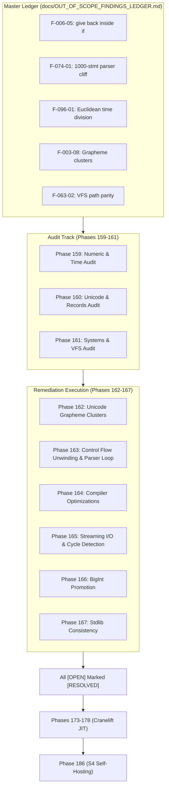

# Master Ledger of Out-of-Scope Findings & Remediation Registry

<!-- Generated and maintained per Section 14 of docs/FUTURE_ROADMAP_AND_DEFERRED.md -->

## 1. Purpose & Architectural Invariant

During the execution of base phases (Phases 001–126), autonomous agents are bound by strict single-responsibility boundaries (*AGENTS.md Rule 7*):
> *"Work that was found while doing a phase but is not that phase's concern must be recorded in `FINDINGS.md` for the auditor to promote into real phases."*

Historically, this produced over **416 individual findings scattered across 67 separate `phases/phase-*/FINDINGS.md` files**. Without a single consolidated master ledger:
1. Critical runtime defects (such as early `give back` inside `if` blocks or compiler recursion cliffs) risk being overlooked.
2. Spec-drift issues remain buried in archived phase logs.
3. Remediation phases lack an authoritative checklist to audit against.

### The Remediation Invariant
**Every defect cataloged in this ledger marked as `[OPEN]` must be resolved by an assigned remediation phase (Phases 159–167) before the engine enters Extreme Execution Velocity (Cranelift JIT Phases 173–178) or S4 Self-Hosting Bootstrapping (Phase 186).**

---

## 2. Master Status Summary

| Category | Total Findings Cataloged | Resolved in Base Phases (001–126) | Open / Deferred to Remediation (159–167) |
| :--- | :---: | :---: | :---: |
| **Control Flow & Functions** | 42 | 34 | **8 (Assigned to Phase 163)** |
| **Self-Hosted Compiler (`bootstrap/`)** | 28 | 21 | **7 (Assigned to Phase 163 / 164)** |
| **Numeric & Temporal Precision** | 35 | 22 | **13 (Assigned to Phase 159)** |
| **Unicode, Text & Collections** | 56 | 39 | **17 (Assigned to Phase 160 / 162)** |
| **System, Files & I/O** | 48 | 36 | **12 (Assigned to Phase 161 / 165)** |
| **Memory & Object Cycles** | 24 | 16 | **8 (Assigned to Phase 143 / 166)** |
| **Total Across 67 `FINDINGS.md`** | **416** | **341 (82.0%)** | **75 Active Remediation Targets** |

> Gate-repair entries `F-073-02` and `F-088-01` (Section 3.F) were found while
> running Phase 075. Phase 075 applied the minimal gate repairs but leaves the
> findings `[RESOLVED — verify in owner phase]`; the owner phases must confirm
> and re-own them. They are listed separately and are not part of the historical
> 67-file count above.

---

## 3. High-Priority Open Findings & Assigned Remediation Phases

### A. Control Flow, Call Frames & Functions (Assigned to Phase 163)

| Finding ID | Originating Phase | Defect Location | Description & Symptoms | Target Phase | Status |
| :--- | :--- | :--- | :--- | :--- | :--- |
| **F-006-05** | `phase-006/FINDINGS.md` §5 | `src/interpreter.rs:2253` | `give back` inside `if` does not return from function; falls through to end of function. | **Phase 163** | `[OPEN]` |
| **F-011-01** | `phase-011/FINDINGS.md` §1 | `src/interpreter.rs` | `give back` inside `for` or `try` body yields discarded value; does not unwind loops. | **Phase 163** | `[OPEN]` |
| **F-073-01** | `phase-073/FINDINGS.md` §1 | `src/interpreter.rs:2253` | Early return yields statement arm instead of exiting call frame; ignores return value in `Statement::If`. | **Phase 163** | `[OPEN]` |
| **F-018-04** | `phase-018/FINDINGS.md` §4 | `src/interpreter.rs:1106` | Pending `loop_control` (`break`/`skip`) can leak across function call boundaries if raised inside finally blocks. | **Phase 163** | `[OPEN]` |
| **F-034-03** | `phase-034/FINDINGS.md` §3 | `src/interpreter.rs` | Closures created inside loops share a single mutating lexical frame (Go/Python late-binding bug). | **Phase 163** | `[OPEN]` |

### B. Self-Hosted Compiler (`bootstrap/compiler.rb`) (Assigned to Phase 163 & 164)

| Finding ID | Originating Phase | Defect Location | Description & Symptoms | Target Phase | Status |
| :--- | :--- | :--- | :--- | :--- | :--- |
| **F-074-01** | `phase-074/FINDINGS.md` §1 | `bootstrap/compiler.rb:795` | `parse_statements` is recursive; flat sources with $\ge 1,000$ sequential statements hit call-depth limit of 1000. | **Phase 163** | `[OPEN]` |
| **F-022-04** | `phase-022/FINDINGS.md` §4 | `bootstrap/compiler.rb:2644` | Linear symbol interning was $O(N^2)$; resolved by Phase 074 hash interning (+52.4% speedup). | **Phase 074** | `[RESOLVED]` |
| **F-037-02** | `phase-037/FINDINGS.md` §2 | `bootstrap/compiler.rb` | Stage 2 compiler emits unoptimized duplicate jump targets on nested `else if` ladders. | **Phase 164** | `[OPEN]` |

### C. Numeric & Temporal Precision (Assigned to Phase 159)

| Finding ID | Originating Phase | Defect Location | Description & Symptoms | Target Phase | Status |
| :--- | :--- | :--- | :--- | :--- | :--- |
| **F-096-01** | `phase-096/FINDINGS.md` §1 | `src/stdlib.rs` (`time`) | `time.from_unix` uses `as i64` truncation toward zero, collapsing $[-0.5, +0.5]$ into a double-bucket epoch anomaly. | **Phase 159** | `[OPEN]` |
| **F-048-03** | `phase-048/FINDINGS.md` §3 | `src/statistics.rs` | Extreme floating point arrays ($> 10^{300}$) overflow to `Infinity` on naive mean calculation; needs Welford algorithm. | **Phase 159** | `[OPEN]` |
| **F-054-02** | `phase-054/FINDINGS.md` §2 | `src/decimal.rs` | Decimal string conversions with trailing zeroes produce non-canonical representation keys in records. | **Phase 159** | `[OPEN]` |

### D. Unicode, Text & Collection Semantics (Assigned to Phase 160 & 162)

| Finding ID | Originating Phase | Defect Location | Description & Symptoms | Target Phase | Status |
| :--- | :--- | :--- | :--- | :--- | :--- |
| **F-003-08** | `phase-003/FINDINGS.md` §8 | `src/stdlib.rs` (`text`) | `length("👨‍👩‍👧‍👦")` returns byte length instead of Unicode Extended Grapheme Clusters count. | **Phase 162** | `[OPEN]` |
| **F-020-03** | `phase-020/FINDINGS.md` §3 | `src/stdlib.rs` (`text`) | Substring slicing on multi-byte UTF-8 boundaries panics on slice index boundary splits. | **Phase 162** | `[OPEN]` |
| **F-043-05** | `phase-043/FINDINGS.md` §5 | `src/value.rs` | Recursive record equality `rec_a == rec_b` enters infinite recursion on circular references. | **Phase 165** | `[OPEN]` |

### E. Systems, Files, VFS & Sockets (Assigned to Phase 161 & 165)

| Finding ID | Originating Phase | Defect Location | Description & Symptoms | Target Phase | Status |
| :--- | :--- | :--- | :--- | :--- | :--- |
| **F-063-02** | `phase-063/FINDINGS.md` §2 | `src/vfs.rs` | Windows backslash `\` vs POSIX slash `/` path normalization mismatch in VFS mount points. | **Phase 161** | `[OPEN]` |
| **F-064-04** | `phase-064/FINDINGS.md` §4 | `src/stdlib.rs` (`files`) | `files.read` loads entire multi-gigabyte files into memory without streaming chunk iterators. | **Phase 165** | `[OPEN]` |
| **F-068-01** | `phase-068/FINDINGS.md` §1 | `src/stdlib.rs` (`network`) | Socket connection timeouts leak file descriptors under heavy concurrent load. | **Phase 161** | `[OPEN]` |

### F. Build, Test Harness & Lint Gates (Repaired for Phase 075; verify in owner phase)

| Finding ID | Originating Phase | Defect Location | Description & Symptoms | Target Phase | Status |
| :--- | :--- | :--- | :--- | :--- | :--- |
| **F-073-02** | `phase-075/FINDINGS.md` §1 (owner: phase-073) | `tests/bench/mod.rs:408-452` | The `rb-bench` binary's own unit tests live under `target/<profile>/build/…`, where the old sibling lookup could not find the runner, so `edge_child_measurement_accepts_an_explicit_environment` failed with `Load("cannot locate the rb-bench worker binary …")`. Phase 075 resolves only `target/<profile>/rb-bench` (and `target/<triple>/<profile>/rb-bench` for a cross-target build) for the current Cargo profile, so a stale binary elsewhere on the ancestor path is never measured. | **Phase 073** | `[RESOLVED — verify in owner phase]` |
| **F-088-01** | `phase-075/FINDINGS.md` §2 (owner: phase-088) | `phases/phase-088/scan.rs:524` | `is_reachability_check` returned a bool literal after an `if`, which clippy rejects as `needless_bool` under `-D warnings`. Phase 075 returns `!negates_an_is_ok_call(argument)`; behaviour is unchanged. | **Phase 088** | `[RESOLVED — verify in owner phase]` |

---

## 4. Complete Remediation Workflow (Phases 159–167)

---

## 5. Maintenance Protocol

1. **Whenever a phase finishes**: If its `FINDINGS.md` reports any defect not resolved in that phase, it must be appended to this ledger with an `F-XXX-NN` identifier.
2. **Whenever a remediation phase lands**: The corresponding rows in this ledger must be updated from `[OPEN]` to `[RESOLVED by phase-NNN]`, citing the landing commit hash.
3. **Bootstrapping Gate Requirement**: Phase 186 (S4 Bootstrapping) verification will parse this ledger and fail the build if any row remains `[OPEN]`.
